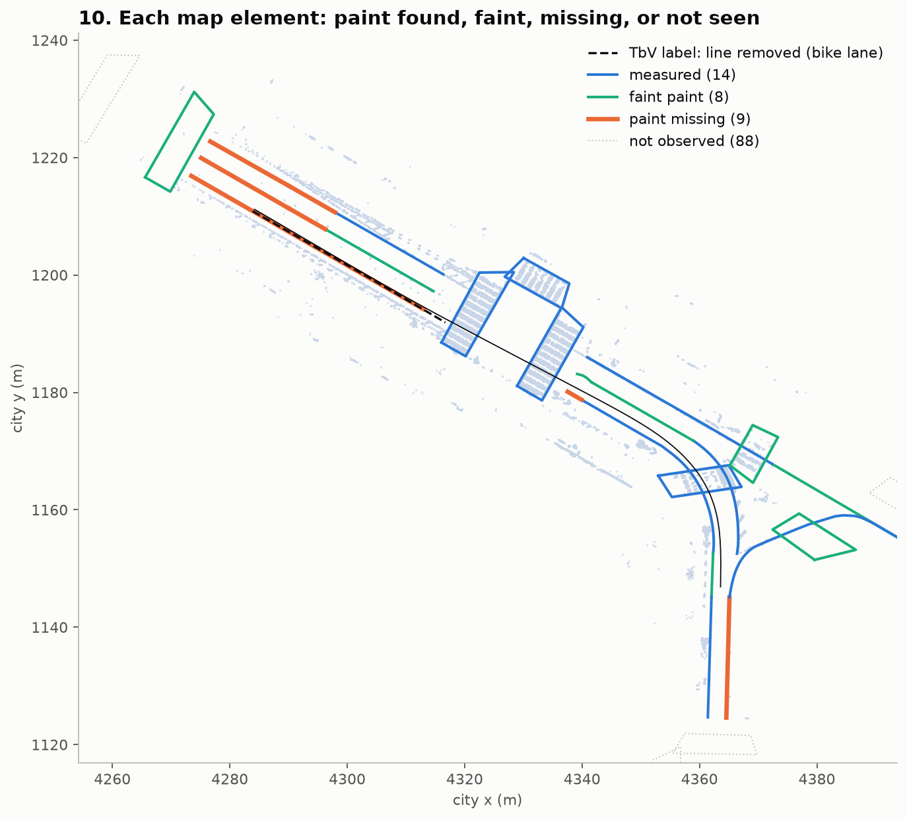
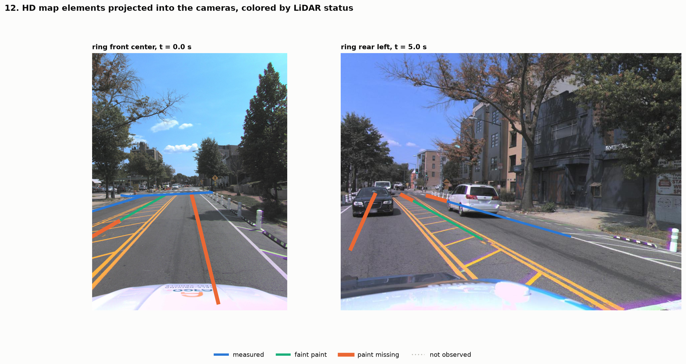

# HD Map Change Detection

Does the HD map still match the road? This project compares vehicle LiDAR against
[Argoverse 2](https://argoverse.github.io/user-guide/datasets/map_change_detection.html) HD maps
to measure how far lane lines and crosswalks are from where the map says, with a confidence score
for each, and (later) wraps it in an agent you can ask questions in plain English.

**First result:** on a Washington DC drive where a lane line was removed for a new bike lane, the
pipeline flags the removed line as *paint missing* (3 / 3 map elements of the labeled change), using
only LiDAR geometry and intensity, no training. Where paint is present, map elements are measured to
within a few cm, and a synthetic test (moving map elements by 10 - 50 cm on purpose) recovers the shift
within 5 cm for every element locked on its line. Projecting the map into the car's cameras confirms it:
the flagged lines lie on bare asphalt.

**Step-by-step walkthrough with figures: [docs/walkthrough.md](docs/walkthrough.md)**

Status and plan: [ROADMAP.md](ROADMAP.md). So far: LiDAR in the map frame, ground segmentation,
lane-paint extraction, per-element deviation + status. Next: a confidence score per element.

Data: [Argoverse 2 TbV](https://argoverse.github.io/user-guide/datasets/map_change_detection.html).
Change labels from [johnwlambert/tbv](https://github.com/johnwlambert/tbv) (CC BY-NC-SA 4.0), used for evaluation only.
