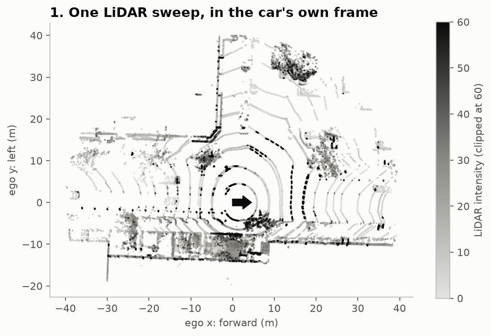
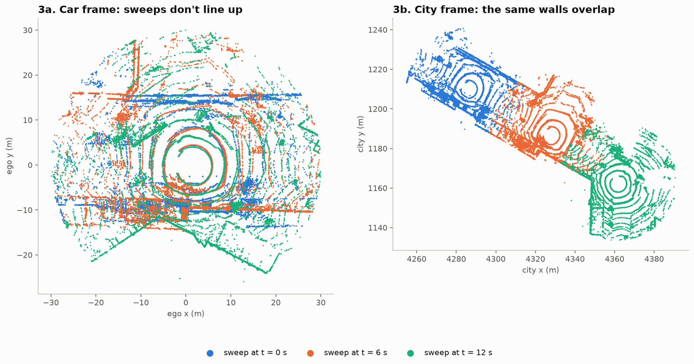
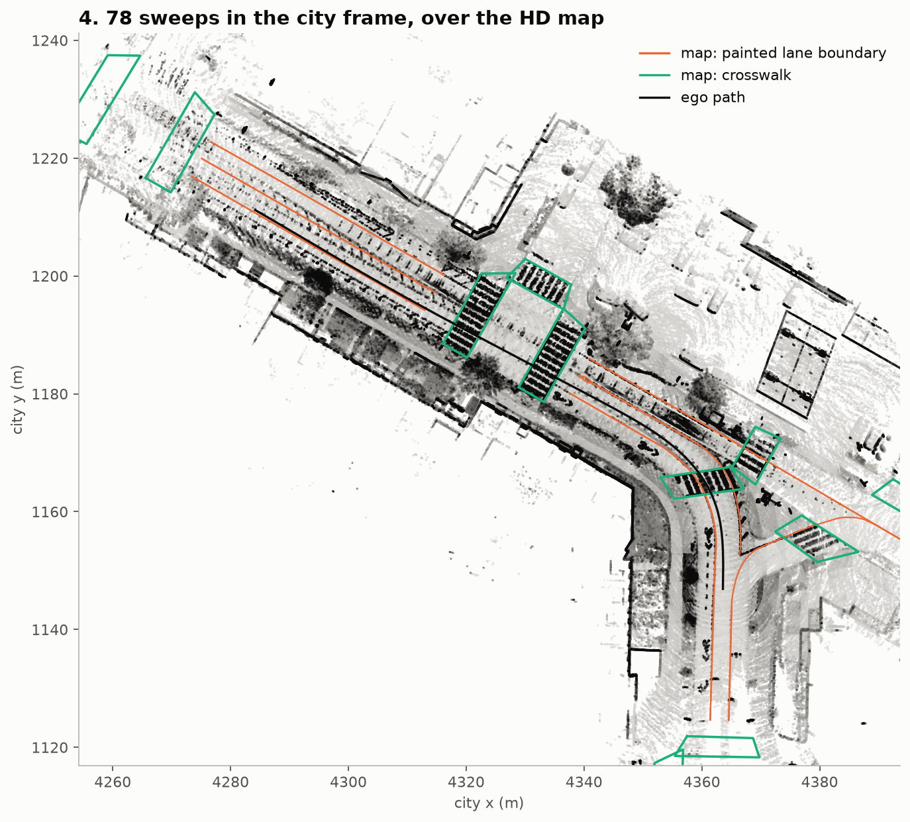
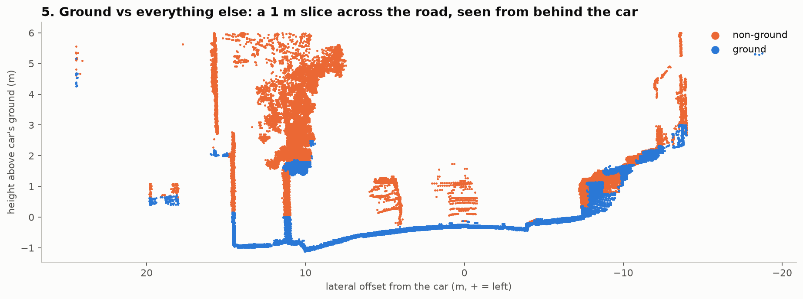
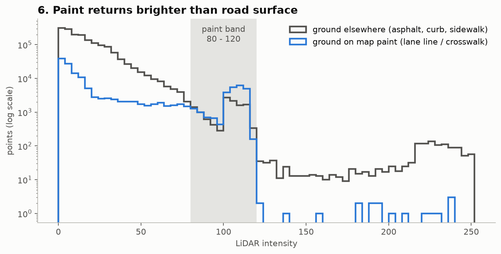
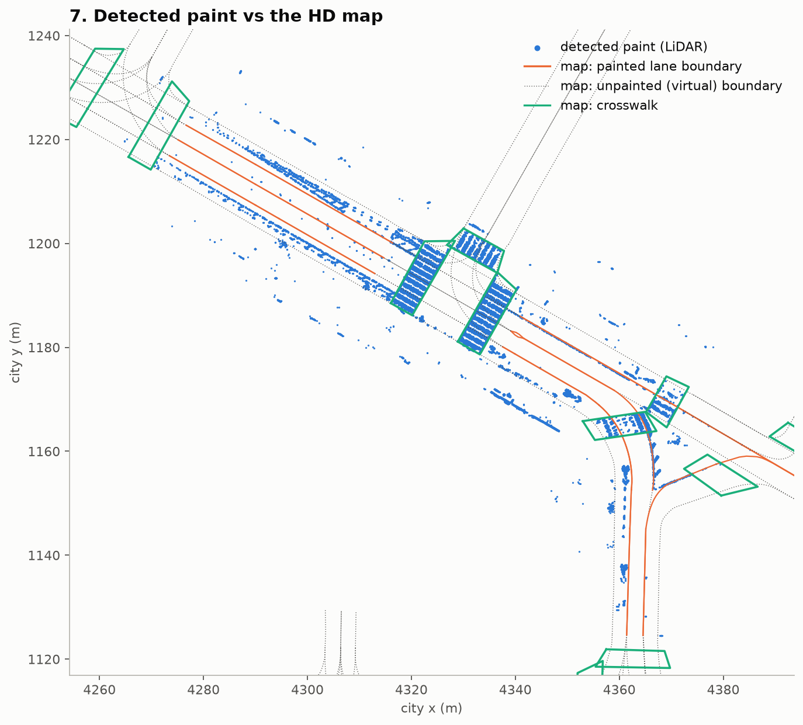
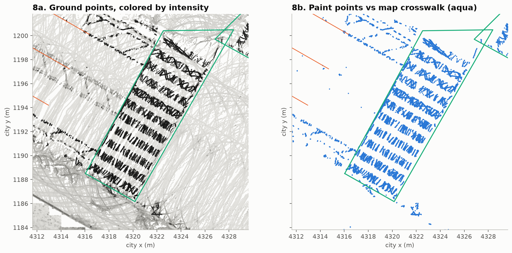
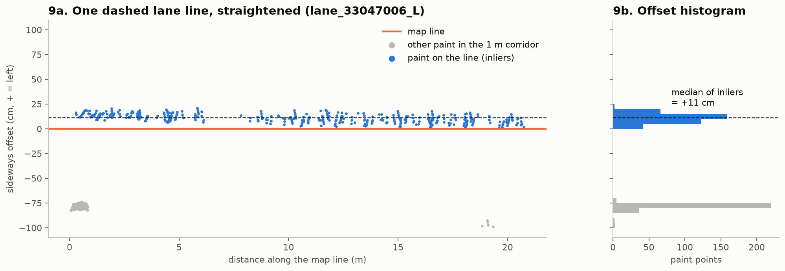
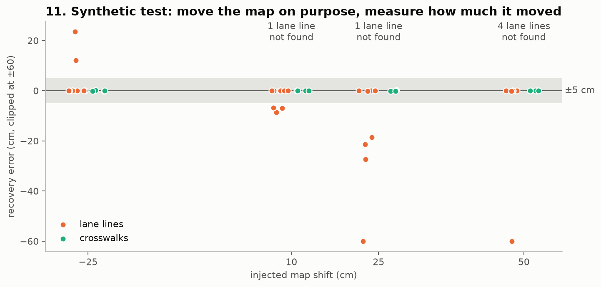

# Walkthrough: from raw LiDAR to "this lane line is gone"

**Question this project answers:** *Is the crosswalk at this intersection still where the map says?*
Autonomous vehicles rely on HD maps (lane lines, crosswalks, stop lines, mapped to centimeters).
Roads get repainted and rebuilt, so the map goes stale. This project compares what the car's LiDAR
actually sees against the map, and reports **how far off each map element is** and **how sure we are**.

Everything below runs on **one 15.5 s drive** from the [Argoverse 2 Map Change (TbV)](https://argoverse.github.io/user-guide/datasets/map_change_detection.html)
dataset, in Washington DC (log `01bb304d…__Summer_2019`). No training: geometry + statistics.
The dataset's change labels are used only to check the result at the end (step 10).
Every figure is regenerated by [`src/make_figures.py`](../src/make_figures.py).

| Step | What happens | Key number |
|---|---|---|
| 1 | Read one LiDAR sweep (car frame) | ~101k points / sweep, 10 Hz |
| 2 | Read the car's poses (city frame) | 2,690 poses over 15.5 s |
| 3 | Transform every sweep into the city frame | 156 sweeps line up |
| 4 | Overlay the HD map | map and LiDAR agree by eye |
| 5 | Keep ground points only | 34% of points are ground |
| 6 | Pick the paint intensity band | 80 - 120 |
| 7 | Paint points vs the map | 67% land on map paint (vs 36% naive) |
| 8 | Zoom: one crosswalk | stripes inside the map polygon |
| 9 | Measure each map element | well-matched elements within 0 - 11 cm |
| 10 | Status per element vs the change label | labeled removed line: 3 / 3 elements flagged |
| 11 | Synthetic test: move the map on purpose | 100% recovered within 5 cm where paint is on the line |

---

## 1. One LiDAR sweep, in the car's frame



A LiDAR spins 10 times a second and measures ~100,000 3D points per turn (a **sweep**).
Each point is stored **relative to the car**: `x` = meters forward, `y` = meters left, `z` = up.
The concentric rings are the ground hit by each of the 64 laser beams; walls and trees break them.
Color = **intensity**, how strongly the surface reflected the laser.

*Example:* a point at `(10, -3, 0)` is 10 m ahead, 3 m to the right, on the road surface.

## 2. Where the car was: ego poses


The vehicle's localization system records its **pose** ~170 times a second: position `(x, y, z)` and
orientation, in a fixed **city frame** shared with the HD map. A pose is an **SE(3) transform**:
a rotation `R` (3x3) and a translation `t` (3-vector).

*Telemetry analogy:* poses are the GPS trace of the vehicle, but centimeter-accurate and with heading.
The arrows show the car's heading every 3 s as it drives down the street and turns right.

## 3. Why poses matter: car frame vs city frame



**Left:** three sweeps, 6 s apart, plotted in their raw car frames. Each is centered on the car, so the
same building appears in three different places. Useless for comparing against a map.

**Right:** each sweep moved into the city frame with its own pose:

```
p_city = R · p_car + t
```

Now the walls from different moments overlap, and the car's path is visible. Poses come at
higher rate than sweeps, so each sweep uses the pose closest in time
([`src/tbv_io.py`](../src/tbv_io.py)).

## 4. All sweeps over the HD map



Stacking 78 sweeps (every 2nd) gives a dense 6.3M-point picture of the street. The HD map
(lane boundaries in orange, crosswalk polygons in aqua) is drawn on top **without any adjustment**.
The zebra crosswalk stripes in the LiDAR fall inside the map polygons: the poses and the map agree.

Interactive version: [`src/view_rerun.py`](../src/view_rerun.py) opens the same data in the
[Rerun](https://rerun.io) 3D viewer with a timeline to scrub through the drive.

<!-- Rerun screenshot: save as docs/figures/09_rerun_viewer.png and uncomment.

-->

## 5. Keep the ground



Lane paint lies on the road, so first drop everything above it: cars, poles, trees, walls.
This is a 1 m-thick slice across the street, seen from behind the car (blue = kept as ground).

**Method** ([`src/paint.py`](../src/paint.py)): split the area into 1 m x 1 m cells; in each cell the
ground height is the 10th-percentile `z`; a point is ground if it is within 20 cm of it.
It uses only the LiDAR, not the map's own ground model, so the map is not checking itself.

**Known limitation, visible here:** where the laser never reaches the true ground (behind a wall,
under a tree canopy), the lowest thing it *does* see is labeled ground, e.g. wall tops at 2 m.
This barely affects paint (step 6 also requires paint-like intensity and < 25 m range), but a
smoothness check between neighboring cells would fix it.

## 6. Paint is brighter than asphalt



Road paint contains glass beads that reflect the laser straight back, so it returns a much higher
intensity than asphalt (median 10-17). To choose a threshold, the map serves as a rough answer key:
ground points near a painted map element (blue) vs everything else (gray).

- Paint has a distinct bump at **80 - 120**. Below that, curbs and concrete sidewalks dominate.
- Above 120 is almost never paint (signs and reflectors that slipped through as ground).
- Intensity fades with distance, so only points seen **within 25 m** are trusted.

| Rule | Share of detected points on map paint |
|---|---|
| intensity >= 50 (naive) | 36% |
| local contrast vs surrounding road | 42 - 59% |
| **80 <= intensity < 120** | **67%** |

The rest is not necessarily wrong: the HD map has no stop lines, arrows or parking stripes,
which are real paint.

## 7. Detected paint vs the HD map



From 6.3M points to **37k paint points** (0.6%). They trace the crosswalks and the lane lines.

One finding for the next step: **193 of the 368 lane boundaries in this map are unpainted**
(dotted). They are virtual lines, e.g. through intersections or along a curb. Measuring a distance
from paint to those would be meaningless, so step 3 of the roadmap only scores painted ones.
Some paint runs along dotted boundaries (road edge lines): worth a closer look.

## 8. Zoom: one crosswalk



**Left:** all ground points, colored by intensity; the zebra stripes stand out.
**Right:** only detected paint, with the map polygon. The stripes sit inside the polygon.

**Known limitation, visible here:** stripes look smeared into "X" shapes. Sweeps from different
moments don't overlap perfectly. Likely causes: (1) each sweep takes 0.1 s while the car moves,
and points aren't corrected for that motion (each point has its own `offset_ns` timestamp);
(2) each sweep uses the nearest pose instead of an interpolated one. This sets a noise floor on
the centimeter-level deviation measured next.

## 9. Measure each map element



For each **painted** lane boundary ([`src/deviation.py`](../src/deviation.py)):

1. Take paint points within 1 m of the map line, and "straighten" the line: for each point, how far
   along the line it is (x axis) and how far to the side, with a sign (+ = left).
2. A real painted line is a dense band of offsets. Find the band (the ±15 cm window holding the most
   points); everything else in the corridor (arrows, symbols, other lines) is ignored.
3. **Deviation = median offset of the band.** Here: the dashed line is painted **11 cm** left of
   where the map puts it. The gray blob at -80 cm is a road marking, correctly ignored.

**Crosswalks** work the same way along the road direction: where does the striped band start and
end, compared to the map polygon's two edges?

*Example of why the sign matters:* random noise scatters points on both sides and averages to ~0.
A map that is 30 cm off puts the whole band 30 cm to one side.

## 10. Status of every element, checked against the change label


A missing measurement can mean two opposite things, so each element gets a **status**:

| Status | Meaning | Rule |
|---|---|---|
| measured | paint found, deviation in cm | band found, >= 2 m long |
| faint paint | something is painted, but dim (yellow lines, worn paint) | no band, but on-line intensity (90th pct) >= 25 |
| **paint missing** | the road was clearly seen, and it is bare asphalt | ground seen along >= 50% of the line, intensity ~ asphalt |
| not observed | the car never saw that stretch | ground seen along < 50% |

**Result on this drive (119 painted map elements):**

| | Count | Notes |
|---|---|---|
| measured | 14 | 9 within 11 cm of the map; 5 at -79 to -97 cm (see below) |
| faint paint | 8 | 3 crosswalks, 3 yellow lines (dimmer than white), 2 white lines |
| **paint missing** | 9 | includes **all 3** elements of the labeled change |
| not observed | 88 | the car drove one street; the map covers more |

**Checking against the label:** this log is labeled in TbV as *"4 lanes turned to 2 lanes, after
new bike lane"*: a dashed white line was removed. All 3 map elements along that line are flagged
**paint missing**. The car drove right over it (0.3 m away), saw 1,200+ ground points on it, and
their intensity is ~6: bare asphalt.

**Honest reading of the other flags:**
- 4 more *paint missing* lines are in the same rebuilt stretch (top left). The label traces one
  line, but "4 lanes turned to 2" implies more were removed; likely real, not confirmed.
- 2 *paint missing* lines elsewhere are unexplained: probable false positives.
- The 5 elements measured at **~80 cm** are ambiguous: is that the map line moved 80 cm, or a
  different line (e.g. the new bike-lane line) next to an old one? One drive can't tell; that's the
  job of the confidence step.

Full table: [`docs/results/deviation_*.csv`](results/) (opens in Numbers / Excel).

## 11. Synthetic test: move the map on purpose



Real labels are rare, so the second check is synthetic: shift each measured map element sideways
by a known amount (-25, +10, +25, +50 cm), measure again, and check the measured change equals
the injected one.

| Elements | Tests | Recovered within 5 cm |
|---|---|---|
| crosswalks | 20 | **100%** |
| lane lines with paint on them (\|offset\| < 30 cm) | 20 | **100%** |
| lane lines at ~80 cm (ambiguous) | 20 | 20% |

So the measurement itself is exact when it is locked on the right line; the failures are exactly
the ambiguous elements from step 10. When the map line moves, a different paint structure enters
or leaves the 1 m search corridor and the method locks onto it instead.

**Known limitations so far:** the paint band (80 - 120) and the "faint" threshold were tuned on this
one drive; yellow paint needs its own band; the 1 m corridor can't measure shifts larger than ~1 m;
pose smear (step 8) adds a few cm of noise.

---

## Next

**Confidence:** turn the evidence already in the table (how many meters of the line were seen,
share of inlier points, spread, competing lines in the corridor, range) into a score per element,
so a 3 cm offset on 20 m of clean line reads differently from an 80 cm offset on 2 m of clutter.
Then evaluation on more drives, match and mismatch. See [ROADMAP.md](../ROADMAP.md).

## Reproduce

```bash
uv venv --python 3.12 .venv && uv pip install --python .venv/bin/python -r requirements.txt
# one log, no camera images (~160 MB)
LOG=01bb304d7bd835f8bbef7086b688e35e__Summer_2019
s5cmd --no-sign-request cp --exclude "*cameras*" "s3://argoverse/datasets/av2/tbv/$LOG/*" data/$LOG/
# TbV change labels (CC BY-NC-SA 4.0, from github.com/johnwlambert/tbv), used only for checking
mkdir -p data/tbv_labels && curl -sL -o data/tbv_labels/tbv_val_split_annotations.json \
  https://raw.githubusercontent.com/johnwlambert/tbv/main/labeled_data/tbv_val_split_annotations.json
.venv/bin/python src/measure_deviation.py data/$LOG     # deviation table + synthetic test (CSV)
.venv/bin/python src/make_figures.py data/$LOG          # all figures above
source .venv/bin/activate && python src/view_rerun.py data/$LOG   # 3D viewer
```
